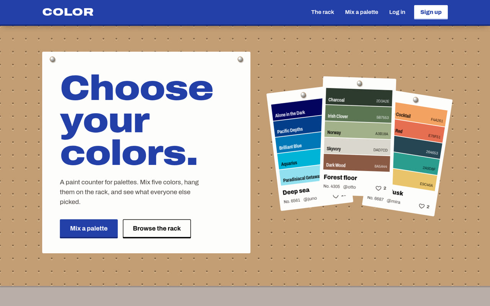
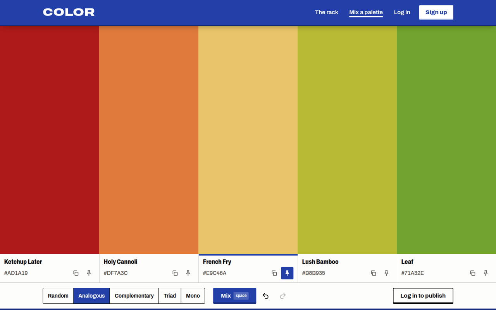
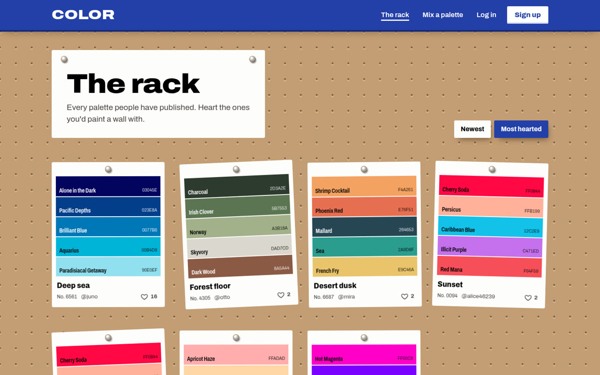
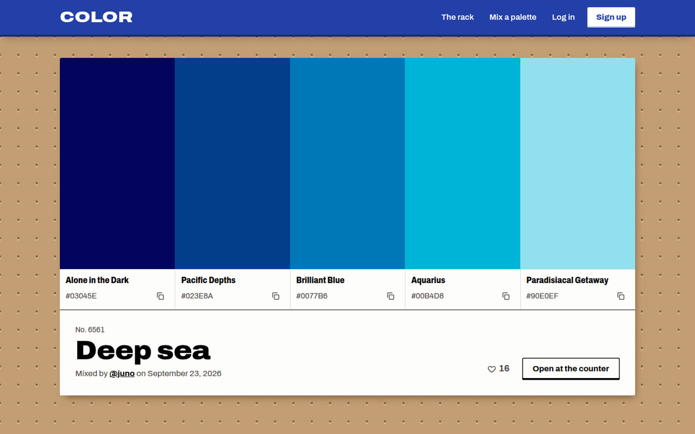
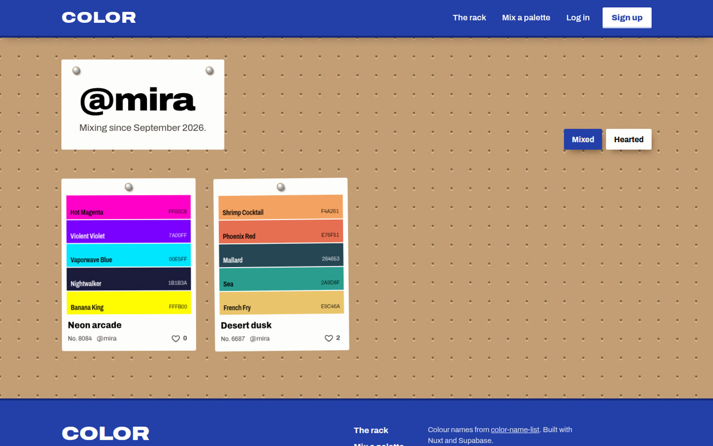
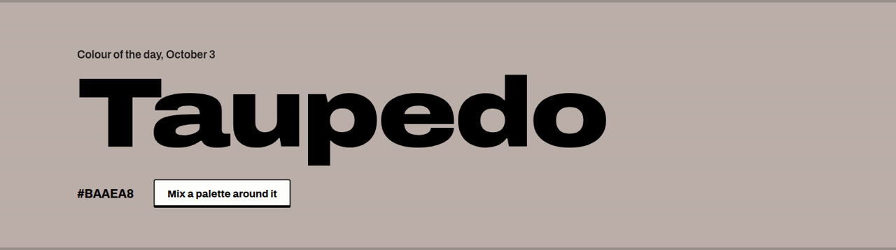
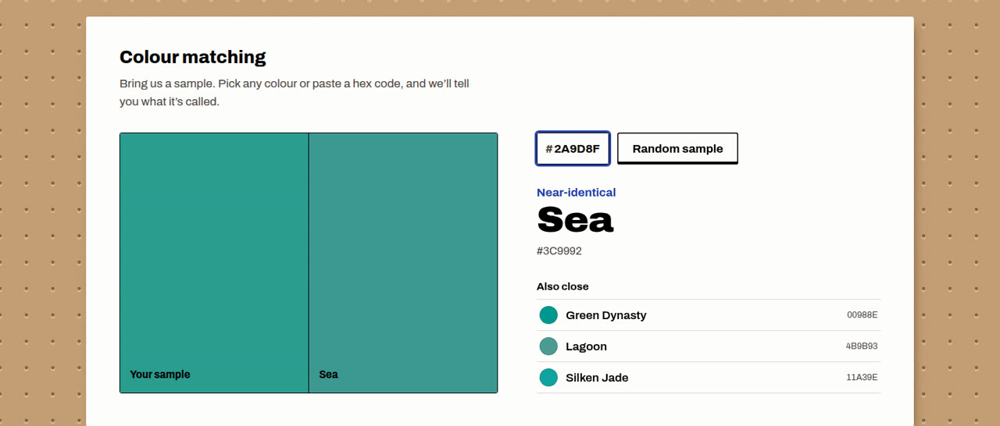
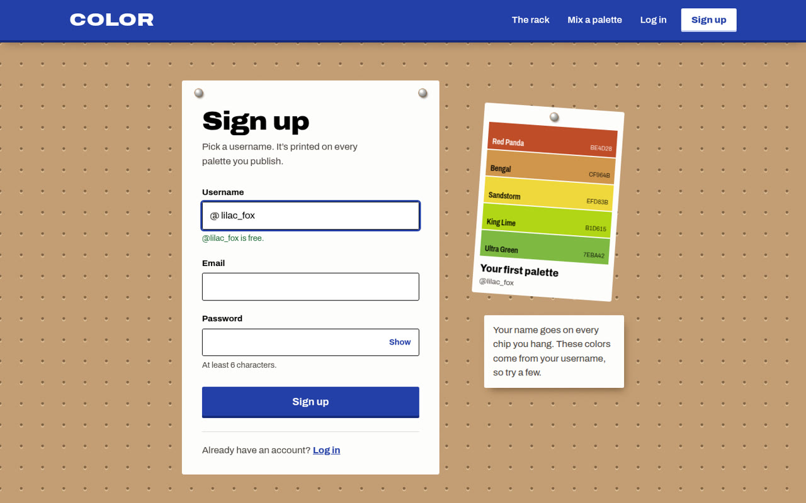
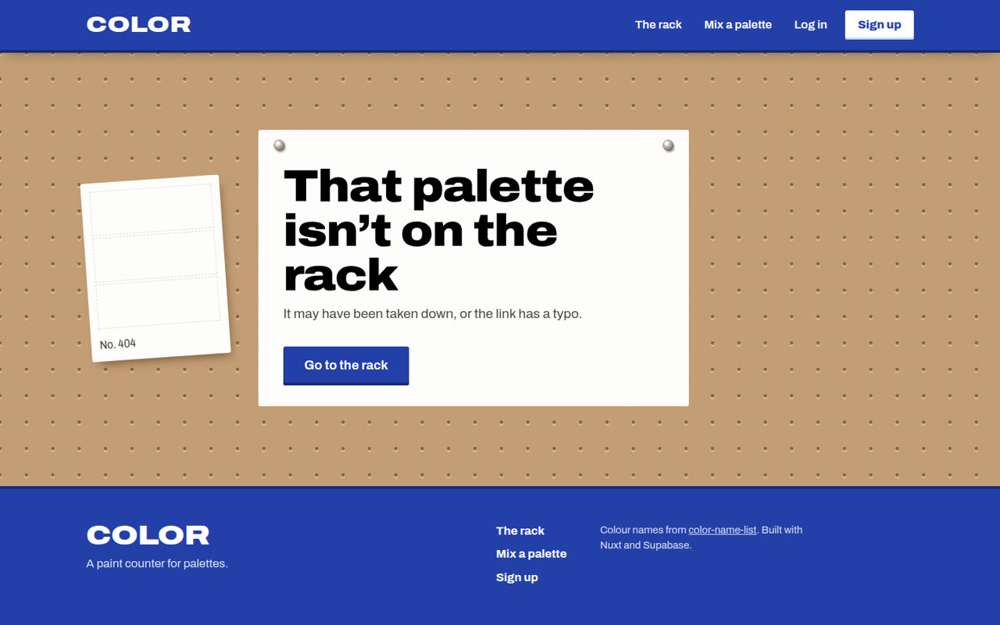

# COLOR

A palette community dressed as a paint counter: the page is a pegboard and palettes hang on it as
paint chips. Mix palettes (random or by harmony — analogous, complementary, triad, mono — with
undo), every colour gets a real name, publish to the rack, and heart other people's. Built with
Nuxt 4 (Vue) and Supabase.

Colour names come from [color-name-list](https://github.com/meodai/color-name-list) (MIT), "best of"
set, matched by nearest colour in OKLab.

Design: [docs/superpowers/specs/2026-09-23-color-community-design.md](docs/superpowers/specs/2026-09-23-color-community-design.md)



## Features

### Mix a palette

Five tall swatches, each with its real colour name underneath.

- Press <kbd>space</kbd> to mix. **Pin** the colours you want to keep and only the rest change.
- Pick a harmony: **Random**, **Analogous**, **Complementary**, **Triad** or **Mono**. The first
  pinned colour sets the base hue.
- Type a hex code straight into any swatch, or copy one with a click.
- **Undo and redo** up to 50 steps (<kbd>Ctrl</kbd>/<kbd>⌘</kbd>+<kbd>Z</kbd>, with
  <kbd>Shift</kbd> or <kbd>Ctrl</kbd>+<kbd>Y</kbd> to redo).
- The palette lives in the URL, so any palette can be shared as a link, and it survives the trip
  through logging in.
- Logged in, give it a name and **publish** it to the rack.



### The rack

Every published palette hangs as a paint chip: five named colour bands, a stock number and a
slight tilt, both worked out from the palette's id, so a chip looks the same wherever it hangs.
Sort by **Newest** or **Most hearted**, 24 at a time with "Load more".



### Palettes and profiles

- Each palette has its own page with large swatches, who mixed it and when, a heart button, and
  **Open at the counter** to load it back into the mixer. Its author can delete it.
- Hearts update straight away and roll back if the save fails.
- Every user has a profile with the palettes they **Mixed** and the ones they **Hearted**.

| A palette | A profile |
| --- | --- |
|  |  |

### Colour of the day and colour matching

- The home page has a **colour of the day**: one named colour, the same for everyone, with a link
  to mix a palette around it.
- **Colour matching**: pick any colour or paste a hex code to get its name, how close the match
  is, and the three next-nearest named colours.





### Accounts

- Sign up with a username, email and password. The username is checked as you type.
- A **preview chip** beside the form shows a palette generated from your username, so every name
  gets its own colours.
- Log in or publish from any page and you come back to where you were.



### Not found

A missing palette or user gets an empty paint chip: that colour isn't in stock.



## Stack

| | |
| --- | --- |
| Framework | [Nuxt 4](https://nuxt.com) (Vue 3, `<script setup>`), server-rendered |
| Language | TypeScript |
| Backend | [Supabase](https://supabase.com): Postgres, Auth and Row Level Security, through [@nuxtjs/supabase](https://supabase.nuxtjs.org). No custom server code: the browser talks to Supabase directly |
| Database logic | SQL triggers for new profiles and like counts, column-level grants, RLS policies |
| Colour | Hand-written colour maths (HSL, harmony, contrast, OKLab), names from [color-name-list](https://github.com/meodai/color-name-list) |
| Styling | Plain scoped CSS, no CSS framework. One typeface: [Archivo](https://fonts.google.com/specimen/Archivo), using its width axis |
| Tests | [Vitest](https://vitest.dev) unit tests, plus `nuxt typecheck` |

## Run it

```bash
npm install
cp .env.example .env   # then fill in SUPABASE_URL and SUPABASE_KEY
npm run dev            # http://localhost:3000
```

### Database

The schema lives in [supabase/migrations/20260923000000_init.sql](supabase/migrations/20260923000000_init.sql):
tables, triggers, grants and Row Level Security.

- **Hosted Supabase:** paste the migration into the SQL editor and run it, or use `npx supabase db push`.
  For local development, turn off Auth → Providers → Email → "Confirm email", or sign-up waits
  for the confirmation link.
- **Local Supabase (Docker):** run `npx supabase start`. It applies the migration and prints
  the URL and publishable key for `.env`. Email confirmation is already off locally.

## Scripts

| | |
|---|---|
| `npm run dev` | dev server with hot reload |
| `npm test` | unit tests: colour, harmony, names, undo |
| `npm run typecheck` | Vue + TypeScript check |
| `npm run build` | production build |

## Where things are

```
app/
  pages/          one file per route (/generate, /explore, /p/[id], /u/[username], …)
  components/     NavBar, Swatch, PaintChip, LikeButton, …
  composables/    usePalettes (every Supabase query), useMyLikes, useAuthRedirect
  middleware/     guest — keeps logged-in users off /login and /signup
  utils/          color.ts (random, harmony, hex, contrast), colorNames.ts, history.ts (undo)
  types/          row types + the Database type for the Supabase client
supabase/         migration + local CLI config
tests/            vitest
```

Security is enforced in Postgres, not in the app. Anyone can read. You can only create or delete
your own palettes and likes. Nobody can edit a palette or its like count from the browser. The
like count only changes through the trigger on `likes`.
